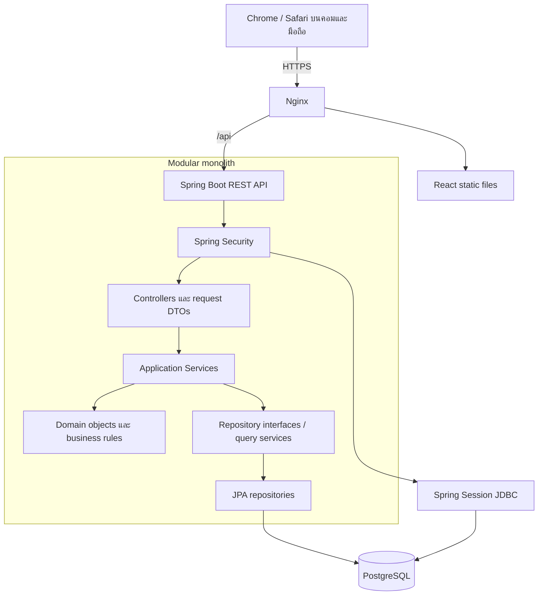
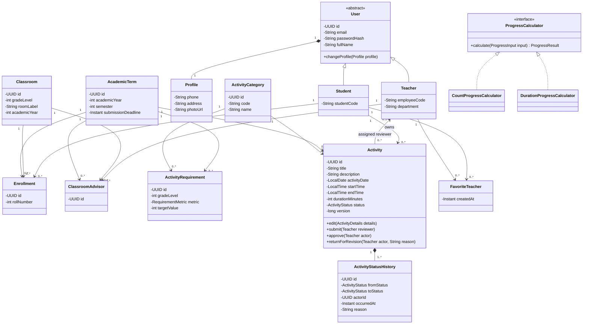
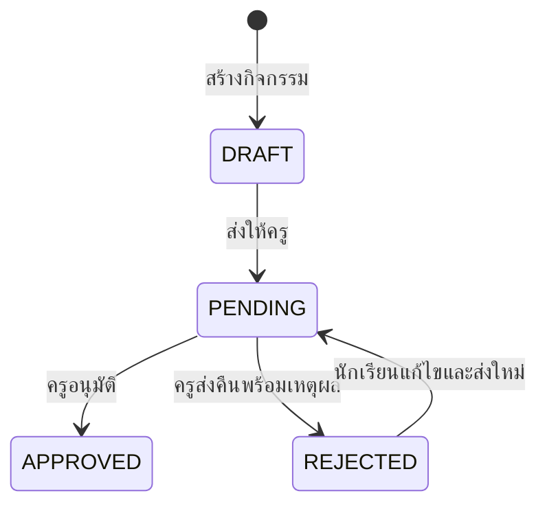

# SAMA: สถาปัตยกรรม OOP และ Tech Stack

สถานะ: ข้อเสนอสำหรับเริ่มพัฒนา อ้างอิง SRS 23 หน้า, UI 13 หน้า และภาพ class diagram ที่ผู้ใช้ส่งมา
วันที่: 25 ตุลาคม 2026

เอกสารนี้เป็นแบบออกแบบตั้งต้น สำหรับโค้ดและระบบปัจจุบันให้อ่าน [คู่มือรายไฟล์](SAMA-code-guide.md), [สถานะการพัฒนา](implementation-status.md) และ [Supabase Auth](SAMA-supabase-auth.md) ประกอบ

## 1. ข้อเสนอหลัก

ใช้ **React + TypeScript สำหรับหน้าเว็บ, Java + Spring Boot สำหรับ backend และ PostgreSQL สำหรับฐานข้อมูล** โดยจัด backend เป็น **modular monolith**: โปรแกรมเดียวที่แบ่งโมดูลตามงาน และแบ่งหน้าที่ Controller, Application Service, Domain, Repository ภายในแต่ละโมดูล

สมมติว่าวิชาไม่ได้บังคับภาษา และทีมทำ Java ได้ การเลือกนี้ช่วยแสดง encapsulation, inheritance, abstraction และ polymorphism ผ่าน business logic ที่ตรวจสอบได้จริง หากทีมใช้ภาษาอื่นอยู่แล้ว ให้คงแบบจำลองและกฎในเอกสารนี้แล้วเปลี่ยนเครื่องมือให้เหมาะกับทีม

OOP อยู่ที่การจัดการข้อมูลและพฤติกรรมของระบบ ไม่จำเป็นต้องทำ React component ทุกตัวเป็น class

## 2. ขอบเขตที่อ่านได้จากเอกสาร

| ความต้องการ | ผลต่อการออกแบบ |
|---|---|
| นักเรียนและครูเข้าสู่ระบบ | Authentication และการตรวจสิทธิ์ทั้งบทบาทและเจ้าของข้อมูล |
| บันทึกแบบร่าง ส่งให้ครู ส่งคืน และส่งใหม่ | Activity มี state transition ที่ควบคุมโดย method |
| Timeline พร้อมผู้ตรวจและเวลา | ActivityStatusHistory เก็บทุกเหตุการณ์ |
| เลือกครูผู้ตรวจจากการค้นหาหรือรายการโปรด | แยก assignedReviewer ออกจากครูที่ปรึกษา |
| ตัวกรองประเภท สถานะ และช่วงวันที่ | ActivitySearchCriteria และ query ที่มี pagination |
| ความคืบหน้า จำนวนครั้ง และชั่วโมง | เกณฑ์ตามหมวดและเทอม พร้อมวิธีคำนวณตามหน่วย |
| สถิติห้องเรียนและนักเรียนรายบุคคล | Classroom, Enrollment และ ClassroomAdvisor |
| เลือกปี/เทอมและนับถอยหลังวันส่ง | AcademicTerm และ submissionDeadline |
| อนุมัติ/ส่งคืนไม่เกิน 50 รายการใน 5 วินาที | BulkReviewService, transaction และ concurrency control |
| คำสั่งทั่วไปไม่เกิน 2 วินาที | Query ตามหน้า, index และวัดผลจริง |
| สถานะใหม่ภายใน 5 วินาทีหลัง refresh | อ่านฐานข้อมูลหลัง commit และ invalidate frontend cache |
| ผู้ใช้พร้อมกันอย่างน้อย 1,000 คน | ต้องทดสอบ workload และ sizing จริง |
| CSV ภาษาไทยและ Cloud Container/Database | UTF-8 CSV, container deployment และ managed PostgreSQL |

ข้อกำหนดด้านเวลาและจำนวนผู้ใช้เป็นเป้าหมายจาก SRS ไม่ใช่ผลทดสอบของแบบสถาปัตยกรรมนี้

## 3. Tech Stack

| ส่วน | เครื่องมือ | เหตุผล |
|---|---|---|
| Backend language | Java 21 | ชนิดข้อมูลชัดเจน เหมาะกับการออกแบบและอธิบาย OOP |
| Backend framework | Spring Boot รุ่น stable ที่รองรับ Java 21 | REST API, validation, transaction และ dependency injection |
| Authentication | Spring Security + Spring Session JDBC | Session ฝั่ง server และเก็บ session ร่วมใน PostgreSQL |
| Persistence | Spring Data JPA / Hibernate | Mapping class กับตาราง, repository และ optimistic locking |
| Database | PostgreSQL | Foreign key, unique/check constraints, transaction และ aggregate query |
| Schema migration | Flyway | ใช้ชุด migration เดียวกันทั้งเครื่องทีมและ server |
| Frontend | React + TypeScript + Vite | เหมาะกับเว็บ responsive และแยก component ตาม UI ที่มี |
| UI styling | CSS Modules หรือ CSS ปกติ + CSS variables | คุมสี ระยะ และหน้าตาตาม Figma ได้ตรง โดยไม่เพิ่ม UI framework ตั้งแต่ต้น |
| Server state | TanStack Query | โหลดข้อมูล, cache และ refetch หลังบันทึก/ตรวจงาน |
| Charts | SVG/CSS สำหรับ progress bar และ donut chart | เพียงพอกับกราฟพื้นฐานใน UI นี้ |
| Backend tests | Spring Boot Test + JUnit + Testcontainers PostgreSQL | ตรวจ business rule และพฤติกรรมฐานข้อมูลจริง |
| End-to-end tests | Playwright | ทดสอบ flow นักเรียนและครู รวม Chromium/WebKit |
| Performance tests | k6 | วัด response time, bulk action และ concurrent workload |
| Development | Maven Wrapper + Docker Compose | ใช้ backend และ PostgreSQL ที่ตั้งค่าซ้ำได้ |
| Deployment | Nginx + backend container + managed PostgreSQL | หน้าเว็บและ API ใช้ origin เดียวผ่าน HTTPS |

Pin เวอร์ชันจริงใน pom.xml, package-lock.json และ container image เมื่อสร้างโปรเจกต์ โดยใช้ dependency management ของ Spring Boot ให้ library ฝั่ง Java เข้ากัน

## 4. ภาพรวมสถาปัตยกรรม



ลำดับคำขอหลัก: Controller รับและตรวจรูปแบบข้อมูล -> Service ตรวจสิทธิ์และเปิด transaction -> Domain object ตรวจ business rule -> Repository บันทึก -> Controller ส่ง response DTO

Controller ไม่คำนวณเกณฑ์ผ่าน และ frontend ไม่เป็นผู้ตัดสินผลผ่านสุดท้าย ฝั่ง backend เป็นแหล่งอ้างอิงผลการคำนวณ

เริ่ม deploy backend หนึ่ง instance ได้ เมื่อเพิ่ม instance ให้ทุก instance ใช้ session store เดียวกัน การเพิ่ม instance เป็นการตั้งค่าระบบ ไม่เปลี่ยนแบบจำลองธุรกิจ

## 5. โมดูลและความรับผิดชอบ

| โมดูล | Class/Service หลัก | หน้าที่ |
|---|---|---|
| identity | User, Student, Teacher, Profile, AuthenticationService | บัญชี บทบาท โปรไฟล์ และเข้าสู่ระบบ |
| academic | AcademicTerm, Classroom, Enrollment, ClassroomAdvisor | เทอม ห้องเรียน สมาชิกห้อง และครูที่ปรึกษา |
| activity | Activity, ActivityCategory, ActivityStatusHistory, ActivityService | สร้าง แก้ไข ส่ง และอ่าน timeline |
| review | ReviewService, BulkReviewService, ReviewAuthorizationPolicy | ตรวจ อนุมัติ ส่งคืน และตรวจสิทธิ์ผู้ตรวจ |
| favorite | FavoriteTeacher, FavoriteTeacherService | ค้นหาครูและบันทึกรายการโปรด |
| progress | ActivityRequirement, ProgressCalculator, ProgressService | เกณฑ์ผ่านและสถิติแยกหมวด/เทอม |
| reporting | ClassroomStatisticsService, CsvReportExporter | สถิติห้องเรียนและส่งออก CSV |

review ใช้ Activity ผ่าน service/repository ที่กำหนดไว้ ส่วน reporting อ่านผ่าน query service หลีกเลี่ยงการให้แต่ละโมดูลเรียกกันวนไปมา

## 6. ปรับ Class Diagram เดิมอย่างไร

1. เก็บ User -> Student / Teacher ไว้ได้ หากผู้ใช้มีบทบาทเดียวตามขอบเขตนี้ ใช้ User เป็น abstract class และ JOINED inheritance เพื่อให้ student/teacher ใช้ user ID เดียวกัน หากอนาคตหนึ่งบัญชีมีหลายบทบาท ค่อยเปลี่ยนเป็น role composition
2. ย้าย login()/logout() จาก User ไป AuthenticationService/Spring Security เพราะเป็นการตรวจ credentials และจัดการ session
3. ย้าย recordActivity()/approveActivity()/downloadStatistics() ที่เป็น orchestration ไป application services แล้วให้ Activity เก็บกฎที่เกี่ยวกับสถานะของตัวเอง
4. เปลี่ยน StudentDashboard, TeacherDashboard, ClassroomStatistic เป็น response DTO/read model ที่คำนวณจากข้อมูลจริง ไม่ทำเป็น entity เก็บยอดซ้ำ
5. เปลี่ยน ActivityFilter เป็น ActivitySearchCriteria ที่รับ status/category/date range/term/page แล้วใช้ query service
6. เปลี่ยน category จาก enum เป็น ActivityCategory entity เพราะมีหลายหมวดและเกณฑ์ต่างกัน ส่วน ActivityStatus ยังเป็น enum ได้
7. เพิ่ม AcademicTerm, ActivityRequirement, Classroom, Enrollment, ClassroomAdvisor และ ActivityStatusHistory
8. FavoriteTeacher เป็น association ระหว่างนักเรียนกับครู และบังคับคู่ student/teacher ไม่ซ้ำ
9. ไม่ใช้ float เก็บเวลา ใช้ durationMinutes เป็น integer ที่คำนวณจากวันและเวลาเริ่ม/จบ
10. เก็บ passwordHash แทน password และไม่ส่ง entity User กลับไปหน้าเว็บ

## 7. Domain Class Diagram ที่เสนอ



Profile เป็น value object ฝังใน users ได้ ไม่มีความจำเป็นต้องแยกเป็นตาราง และเส้น composition ของ history สื่อว่า history เป็นส่วนหนึ่งของ activity โดยระบบต้องเก็บประวัติไว้ ไม่เปิด cascade delete ผ่าน API ปกติ

## 8. OOP ที่ใช้จริง

| หลักการ | การใช้ใน SAMA |
|---|---|
| Encapsulation | status เป็น private เปลี่ยนได้ผ่าน submit/approve/returnForRevision เท่านั้น |
| Inheritance | Student และ Teacher สืบทอดข้อมูลร่วมจาก User |
| Abstraction | Application Service ใช้ repository interface และ ProgressCalculator |
| Polymorphism | CountProgressCalculator และ DurationProgressCalculator ถูกเรียกผ่าน interface เดียวกัน |
| Composition | User มี Profile และ Activity มีประวัติสถานะ |
| Dependency injection | Spring inject repository/calculator/service ผ่าน constructor |

ใช้ Strategy pattern กับการคำนวณความคืบหน้าที่มีสองวิธีอยู่จริง ส่วนสถานะเพียงสี่สถานะเริ่มด้วย enum และ guard clauses ได้ ไม่ต้องสร้าง class ต่อสถานะตั้งแต่ต้น

ตัวอย่างแกนพฤติกรรม (ย่อ ไม่ใช่โค้ดพร้อมรัน):

```java
public void approve(UUID actorId, Instant now) {
    if (status != ActivityStatus.PENDING) {
        throw new InvalidActivityStateException();
    }
    if (!assignedReviewerId.equals(actorId)) {
        throw new ReviewerNotAllowedException();
    }
    changeStatus(ActivityStatus.APPROVED, actorId, now, null);
}
```

Service ตรวจว่า actor เป็นครูและยังมีสิทธิ์ใช้งาน จากนั้นโหลด Activity และเรียก method นี้ การเปลี่ยนสถานะกับการเพิ่ม history ต้อง commit ใน transaction เดียวกัน

## 9. สถานะและกฎธุรกิจ



REJECTED แสดงบนหน้าจอเป็น “ส่งคืน” เพื่อให้ตรงความหมายใน SRS: นักเรียนแก้และส่งใหม่ได้

- นักเรียนแก้รายละเอียดได้เมื่อ DRAFT หรือ REJECTED ของตนเองเท่านั้น ขณะแก้รายการส่งคืนให้คง REJECTED จนกดส่งใหม่
- ส่งตรวจต้องมีหมวด เทอม ข้อมูลจำเป็นครบ และครูผู้ตรวจที่ใช้งานได้ แบบร่างอนุญาตข้อมูลบางช่องยังไม่ครบ
- PENDING มีผู้ตรวจที่ได้รับมอบหมาย และนักเรียนแก้รายละเอียดไม่ได้
- APPROVED แก้ไขไม่ได้ใน MVP และนับความคืบหน้าเพียงครั้งเดียว
- ครูส่งคืนต้องระบุเหตุผล เก็บครู เวลา และเหตุผลใน history
- เวลาเริ่มต้องก่อนเวลาจบ ข้อเสนอ MVP รองรับกิจกรรมภายในวันเดียว กิจกรรมข้ามวันต้องขยายเป็น start/end datetime ก่อนรองรับ
- “ยังไม่ได้ทำ” เป็นค่าคงเหลือตามเกณฑ์ ไม่ใช่สถานะของ Activity
- Deadline ใช้แสดงการนับถอยหลังก่อน ยังไม่ปฏิเสธการส่งช้าโดยอัตโนมัติจนกว่าจะยืนยันกติกา
- กรณีบันทึกและส่งทันที ให้สร้าง event DRAFT และ PENDING ใน transaction เดียวเพื่อให้ Timeline มีทั้งสองขั้น
- History เรียงด้วย occurredAt และ sequence/id เพื่อไม่กำกวมเมื่อเกิดหลาย event ในเวลาเดียวกัน

## 10. เกณฑ์ผ่านและสถิติ

ActivityRequirement ระบุ term, gradeLevel, category, metric และ targetValue ตัวอย่าง metric ได้แก่ COUNT และ DURATION_MINUTES ตัวเลขตัวอย่างใน UI ไม่ใช่ข้อกำหนดที่ยืนยันแล้ว ต้องตั้งค่าจากเกณฑ์โรงเรียน

แต่ละหมวดคำนวณดังนี้:

```text
COUNT: approvedValue = จำนวน Activity สถานะ APPROVED ของหมวด/เทอมนั้น
DURATION_MINUTES: approvedValue = ผลรวม durationMinutes ของรายการ APPROVED
remaining = max(0, targetValue - approvedValue)
progress = min(100, approvedValue / targetValue * 100)
completed = approvedValue >= targetValue
```

- targetValue ต้องมากกว่า 0 และหน่วยต้องตรงกับ metric
- ใช้ผลอนุมัติเท่านั้นเป็นเครดิตผ่าน ส่วน pending/rejected/draft แสดงเป็นจำนวนรายการแยกต่างหาก
- เปอร์เซ็นต์รวมที่เสนอ: ค่าเฉลี่ยเปอร์เซ็นต์ของทุกหมวดที่บังคับ โดยจำกัดแต่ละหมวดที่ 100% ก่อนเฉลี่ย ใช้น้ำหนักเท่ากันจนกว่าจะยืนยันกฎโรงเรียน
- ผ่านทั้งเทอมเมื่อผ่านทุกหมวดที่กำหนด แม้ UI เลือกดูแค่บางหมวด ผล “ผ่านทั้งเทอม” ยังอ้างอิงทุกหมวด ต้องแยกชื่อผลตามตัวกรองออกจากผลทั้งเทอม
- ไม่เอา “ชั่วโมง” และ “ครั้ง” มารวมเป็นยอดดิบเดียวกัน
- ยอด dashboard คำนวณผ่าน aggregate query ไม่บวก counter ด้วย client และไม่เก็บเป็นยอดถาวรซ้ำกับกิจกรรม
- หากไม่มีเกณฑ์ของเทอม ให้ตอบสถานะ “ยังไม่ได้ตั้งค่าเกณฑ์” ไม่แสดงผ่านอัตโนมัติ
- UI ตัวอย่างหน้า 5 มีตัวเลขหัวข้อ/ยอดย่อยที่ไม่สอดคล้องกัน จึงต้องให้ API ส่งผลลัพธ์จากสูตรเดียวกันทั้ง card, chart และ CSV
- ปีการศึกษาเก็บค่าปีที่ระบบกำหนดให้ชัดเจน แนะนำ ค.ศ. ในฐานข้อมูลและแสดง พ.ศ. บน UI; event timestamp เก็บ UTC และแสดง Asia/Bangkok ส่วนวันที่ทำกิจกรรมใช้ DATE ตามวันท้องถิ่น

## 11. แบบฐานข้อมูล

| ตาราง | คีย์/ข้อมูลสำคัญ |
|---|---|
| users | id UUID PK, email UNIQUE, password_hash, full_name, phone, address, photo_url, enabled |
| students | user_id PK/FK users, student_code UNIQUE |
| teachers | user_id PK/FK users, employee_code UNIQUE, department |
| academic_terms | id, academic_year, semester, submission_deadline; UNIQUE(year, semester) |
| classrooms | id, academic_year, grade_level, room_label; UNIQUE(year, grade, room) |
| enrollments | id, student_id, classroom_id, term_id, roll_number; UNIQUE(student_id, term_id), UNIQUE(classroom_id, term_id, roll_number) |
| classroom_advisors | id, teacher_id, classroom_id, term_id; UNIQUE(teacher_id, classroom_id, term_id) |
| activity_categories | id, code UNIQUE, name, active |
| activity_requirements | id, term_id, grade_level, category_id, metric, target_value; UNIQUE(term_id, grade_level, category_id) |
| activities | id, student_id, term_id, category_id, reviewer_id NULL สำหรับแบบร่าง, title, description, activity_date, start_time, end_time, duration_minutes, status, version, created_at, updated_at, submitted_at |
| activity_status_history | id, activity_id, actor_id, sequence, from_status, to_status, reason, occurred_at; UNIQUE(activity_id, sequence) |
| favorite_teachers | student_id, teacher_id, created_at; PK(student_id, teacher_id) |
| spring_session / spring_session_attributes | ใช้ schema ของ Spring Session JDBC |

ทุก foreign key อ้างอิงชนิดผู้ใช้ให้ถูกต้อง; activities.student_id อ้าง students, reviewer_id อ้าง teachers ส่วน history.actor_id อ้าง users

Index เริ่มต้น:

```text
activities(student_id, term_id, status, created_at DESC)
activities(reviewer_id, status, submitted_at DESC)
activities(student_id, term_id, category_id, activity_date)
activity_status_history(activity_id, occurred_at, sequence)
enrollments(classroom_id, term_id)
classroom_advisors(teacher_id, term_id)
```

ตรวจด้วย EXPLAIN จาก query จริงก่อนเพิ่ม index อื่น และตรวจว่าเทอมของ enrollment อยู่ในปีของ classroom ฝั่ง service

## 12. REST API เริ่มต้น

| Method | Endpoint | งาน |
|---|---|---|
| GET | /api/auth/csrf | รับ CSRF token ตามการตั้งค่า Spring Security |
| POST | /api/auth/login | เข้าสู่ระบบและสร้าง session |
| POST | /api/auth/logout | ยกเลิก session |
| GET / PATCH | /api/me | อ่าน/แก้โปรไฟล์ที่อนุญาต |
| GET | /api/terms | รายการปี/เทอม |
| GET | /api/activity-categories?termId=... | หมวดและเกณฑ์สำหรับนักเรียนปัจจุบัน |
| GET | /api/teachers?search=...&page=... | ค้นหาครู |
| GET | /api/me/favorite-teachers | รายการโปรด |
| PUT / DELETE | /api/me/favorite-teachers/{teacherId} | เพิ่มแบบ idempotent / ลบรายการโปรด |
| GET / POST | /api/activities | รายการของตนเอง / สร้างแบบร่าง |
| GET / PATCH | /api/activities/{id} | อ่าน/แก้ข้อมูลกิจกรรมตามสิทธิ์ |
| POST | /api/activities/{id}/submit | ส่งตรวจพร้อม reviewerId |
| GET | /api/activities/{id}/history | Timeline |
| GET | /api/reviews?status=PENDING&page=... | งานของครูผู้ตรวจปัจจุบัน |
| POST | /api/reviews/bulk | อนุมัติหรือส่งคืน 1-50 รายการ |
| GET | /api/me/progress?termId=... | ความคืบหน้านักเรียน |
| GET | /api/classrooms/{id}/statistics?termId=... | สถิติห้องในที่ปรึกษา |
| GET | /api/students/{id}/progress?termId=... | สถิติรายคนตามสิทธิ์ที่ปรึกษา |
| GET | /api/classrooms/{id}/statistics.csv?termId=... | CSV จากสูตร/ตัวกรองเดียวกับ dashboard |

รายการกิจกรรมรับ status, categoryId, fromDate, toDate, termId, page และ size โดย server จำกัด page size และ whitelist sort fields

ใช้ 400 สำหรับรูปแบบข้อมูลผิด, 401 เมื่อยังไม่ login, 403/404 ตามนโยบายการเปิดเผยทรัพยากร และ 409 เมื่อสถานะหรือ version เปลี่ยนแล้ว ส่ง error code ที่ UI แปลเป็นภาษาไทยได้

## 13. Bulk review และการตรวจซ้ำ

ตัวอย่าง request:

```json
{
  "items": [
    { "activityId": "<uuid>", "expectedVersion": 3 },
    { "activityId": "<uuid>", "expectedVersion": 1 }
  ],
  "decision": "REJECT",
  "reason": "กรุณาเพิ่มรายละเอียดกิจกรรม"
}
```

แนวทาง MVP ใช้ **all-or-nothing** ภายใน transaction เดียว:

1. ตรวจว่า items มี 1-50 รายการ ไม่มี ID ซ้ำ และครูเข้าสู่ระบบแล้ว
2. โหลดกิจกรรมด้วย query เดียว แล้วตรวจว่าพบครบ เป็น PENDING และ reviewer ตรงกับครูปัจจุบันทุกตัว
3. ตรวจ expectedVersion และใช้ JPA @Version เพื่อกันการเขียนชนกันจริงระหว่าง commit
4. เรียก approve()/returnForRevision() ของแต่ละ Activity และเพิ่ม history
5. flush และ commit ทั้งชุด ถ้ารายการหนึ่งขัดแย้ง ให้ rollback ทั้งชุดและตอบ 409 เพื่อให้ UI โหลดรายการใหม่
6. ส่งผลสำเร็จหลัง commit แล้ว UI invalidate รายการค้างตรวจ ประวัติ และสถิติ

คำขอซ้ำกับรายการที่ตรวจไปแล้วจะตอบ conflict โดยไม่เพิ่มเครดิตหรือ history ซ้ำ ห้ามให้ bulk SQL ข้าม version checks/domain guards หากใช้ batch update ต้องรักษาเงื่อนไขเหล่านี้ด้วย

“เลือกทั้งหมด” ใน MVP หมายถึงรายการที่โหลดอยู่ โดยไม่เกิน 50 รายการ UI ต้องบอกขอบเขตนี้ชัดเจน

## 14. สิทธิ์และ Session

- นักเรียนอ่าน/แก้กิจกรรมของตนเองและดูสถิติตนเองได้
- ครูตรวจเฉพาะกิจกรรมที่ถูกส่งให้ตนเอง ครูที่ปรึกษาดูสถิติของนักเรียนในห้องที่รับผิดชอบตามเทอมนั้นได้
- การเป็นครูที่ปรึกษาไม่ได้ให้สิทธิ์ตรวจแทนครูผู้รับผิดชอบโดยอัตโนมัติ
- Profile PATCH ไม่รับ role, studentId, classroomId หรือ passwordHash จาก client
- ใช้ password hashing ผ่าน PasswordEncoder ของ Spring Security; ไม่เขียนระบบเข้ารหัสรหัสผ่านเอง
- Session cookie ใช้ HttpOnly, Secure และ SameSite ที่เหมาะกับ same-origin deployment; เปิด CSRF protection สำหรับคำสั่งเปลี่ยนข้อมูล
- หมุน session ID เมื่อ login และ invalidate เมื่อ logout; CSRF token ต้องโหลดใหม่ตาม lifecycle ที่ Spring Security กำหนด
- ทั้งบทบาทและ ownership ต้องตรวจที่ backend ทุก endpoint รวม history, export และสถิติ
- ไม่ส่ง passwordHash หรือข้อมูลภายใน entity ออก API; ใช้ DTO เฉพาะงาน
- CSV ใช้ UTF-8 พร้อม BOM เพื่อเปิดภาษาไทยสะดวก และป้องกัน spreadsheet formula injection สำหรับข้อความจากผู้ใช้
- ไม่บันทึกรหัสผ่าน session token หรือเนื้อหาส่วนบุคคลทั้ง request ลง log

## 15. การอัปเดตข้อมูลและประสิทธิภาพ

SRS ระบุว่าสถานะใหม่ต้องปรากฏภายใน 5 วินาทีหลังรีเฟรช จึงเริ่มจาก GET หลัง transaction commit และตั้งค่า TanStack Query ให้ invalidation/refetch ทำงานถูกต้องได้ โดยไม่เปิด cache ฝั่ง proxy สำหรับ API ส่วนบุคคล

เมื่อต้องการอัปเดตอัตโนมัติขณะเปิดหน้า ใช้ refetch เมื่อ focus หรือ polling แบบจำกัดเฉพาะหน้าที่จำเป็นก่อน หากเพิ่ม polling ทุก 5 วินาทีสำหรับ 1,000 ผู้ใช้ จะมีประมาณ 200 requests/วินาทีต่อหนึ่ง query จึงต้องรวมไว้ใน load test; ค่อยพิจารณา SSE หากยืนยันว่าต้อง push จริง

แนวทางทดสอบก่อนอ้างว่ารองรับ 1,000 คน:

- Seed ข้อมูลหลายเทอม หลายห้อง และจำนวนกิจกรรมใกล้ของจริง
- จำลอง 1,000 active sessions ตามสัดส่วนอ่าน/บันทึก/ตรวจจริง พร้อม think time และ ramp-up
- วัดแยก API ทั่วไป, bulk 50 รายการ, dashboard, CSV และเวลาหน้าจอ end-to-end
- บันทึก p50/p95/p99, maximum, error rate, CPU/RAM, database connections และ slow queries
- ใช้ p95 เป็นตัวชี้วัดเพื่อหาคอขวดได้ แต่ไม่ใช้ p95 ผ่านแทนการยืนยันข้อกำหนด “ไม่เกิน” ทุกคำสั่ง ต้องตกลงวิธีวัดกับผู้ตรวจงานให้ชัดเจน
- จำกัด connection pool ให้สัมพันธ์กับทรัพยากร PostgreSQL และจำนวน backend instances
- ใช้ aggregate query แทนโหลดกิจกรรมทุกคนเข้า Java มาวน และระวัง N+1 queries
- ทดสอบกรณีครูสองหน้าต่างตรวจรายการเดียวกัน และ bulk ที่มีรายการถูกตรวจไปแล้วหนึ่งตัว

Container หรือ cloud tier ขนาดเล็กเพียงอย่างเดียวไม่ยืนยันความสามารถรองรับผู้ใช้ ต้องรายงานสภาพแวดล้อมและผลวัดประกอบ

## 16. โครงสร้างโปรเจกต์

```text
sama/
  backend/
    pom.xml
    mvnw, mvnw.cmd
    src/main/java/th/ac/sama/
      identity/{api,application,domain,infrastructure}/
      academic/{api,application,domain,infrastructure}/
      activity/{api,application,domain,infrastructure}/
      review/{api,application,domain,infrastructure}/
      favorite/{api,application,domain,infrastructure}/
      progress/{api,application,domain,infrastructure}/
      reporting/{api,application,infrastructure}/
      shared/{config,error,security}/
    src/main/resources/db/migration/
    src/test/java/th/ac/sama/
  frontend/
    src/
      app/
      features/{auth,profile,activities,reviews,favorites,progress}/
      components/
      lib/{api,query,dates}/
      styles/
  infra/
    compose.yaml
    nginx.conf
  docs/
    SAMA-architecture.md
```

ในแต่ละโมดูล: api = controllers/DTOs; application = use-case services/transaction; domain = entities/value objects/policies/interfaces; infrastructure = JPA/query adapters และการเชื่อมต่อภายนอก ไม่ต้องสร้าง interface ให้ทุก class ใช้ตรงจุดที่แยกขอบเขตหรือมีหลาย implementation จริง

## 17. ลำดับพัฒนาและเกณฑ์รับงาน

| ขั้น | ผลลัพธ์ที่ต้องใช้งานได้ |
|---|---|
| 1 | Migration, seed บัญชีสองบทบาท, เทอม, ห้อง, หมวด, เกณฑ์, login/logout และ ownership |
| 2 | นักเรียนบันทึกแบบร่าง แก้ไข เลือกผู้ตรวจ ส่ง และดู timeline |
| 3 | ครูดูค้างตรวจ อนุมัติ ส่งคืน และนักเรียนส่งใหม่ |
| 4 | Bulk สูงสุด 50 พร้อม transaction/version และกรณี conflict |
| 5 | ตัวกรอง รายการโปรด โปรไฟล์ และ dashboard นักเรียน |
| 6 | Dashboard ห้อง สถิติรายคน และ CSV ที่ยอดตรงกับหน้าจอ |
| 7 | Responsive, Safari, security regression และ load test |

ชุดทดสอบที่มีคุณค่าต่อขอบเขตนี้:

- นักเรียน A อ่าน/แก้กิจกรรมของ B ไม่ได้
- ครูที่ไม่ได้รับมอบหมายตรวจงานไม่ได้ และครูที่ไม่ใช่ที่ปรึกษาดูสถิติห้องนั้นไม่ได้
- pending แก้รายละเอียดไม่ได้; rejected แก้และส่งใหม่ได้
- approved เท่านั้นที่สะสม; ส่งใหม่และกดซ้ำไม่ทำให้เครดิตเพิ่มซ้ำ
- bulk มีหนึ่งรายการผิดสิทธิ์หรือ version เปลี่ยน ต้องไม่เปลี่ยนรายการอื่นในชุด
- Timeline ไม่หายเมื่อส่งคืนแล้วส่งใหม่
- ย้ายห้อง/เปลี่ยนเทอมแล้วรายงานย้อนหลังยังสัมพันธ์กับ enrollment เดิม
- COUNT และ DURATION_MINUTES คิดได้ถูก ไม่เฉลี่ยหน่วยดิบเข้าด้วยกัน
- CSV กับ dashboard ของ term/filter เดียวกันได้ยอดเดียวกัน

## 18. ประเด็นที่ยังต้องยืนยันก่อนตรึงสเปก

1. เกณฑ์จริงของแต่ละหมวดเป็นจำนวนครั้ง ชั่วโมง หรือมีทั้งสองเงื่อนไข และแยกชั้น/เทอมอย่างไร
2. สูตรเปอร์เซ็นต์รวมต้องเฉลี่ยเท่ากันหรือมีน้ำหนัก
3. หลังพ้น deadline ยังส่งได้หรือไม่ และครูอนุมัติย้อนหลังได้ถึงเมื่อใด
4. UI มี “ยกเลิกตรวจ” แต่ SRS ส่วนข้อกำหนดหลักยังไม่อธิบายกติกา หากต้องทำ ให้เพิ่ม review reversal event พร้อมเหตุผล/สิทธิ์ และย้อนเครดิตอย่างถูกต้อง แยกจากแก้ประวัติเดิม
5. UI มีสมัครบัญชี ลืมรหัสผ่าน ลบบัญชี ชุมชน และติดต่อแอดมิน ซึ่ง SRS ยังไม่กำหนด flow ครบ ข้อเสนอ MVP ใช้บัญชี seed/นำเข้าโดยผู้ดูแล และยังไม่รวมฟีเจอร์เหล่านี้จนตกลงขอบเขต
6. หลักฐานแนบดำเนินการแล้วตามคำขอเพิ่มเติม: ActivityAttachment เก็บข้อมูลไฟล์และ bytes ใน PostgreSQL พร้อม API ที่ตรวจสิทธิ์ จำกัด 5 ไฟล์ ไฟล์ละ 5 MB และแก้ได้เฉพาะ DRAFT/REJECTED หากขยายการใช้งานค่อยย้าย bytes ไป object storage โดยคงสิทธิ์ผ่าน service เดิม ส่วนหมวดที่บังคับแนบต้องยืนยันเกณฑ์
7. SRS ระบุโรงเรียนจุฬาภรณราชวิทยาลัย ชลบุรี แต่ UI ใช้ชื่อโรงเรียนตัวอย่าง ควรใช้ school configuration จุดเดียว
8. ใครเป็นผู้จัดการบัญชี เทอม เกณฑ์ และห้องเรียนในระบบจริง; MVP ใช้ migration/seed ส่วนระบบใช้งานจริงต้องมีช่องทางดูแลข้อมูลที่ชัดเจน

รายการข้างต้นไม่ขัดขวางการเริ่มทำโครงหลัก แต่มีผลต่อการยืนยันว่าระบบครบตามงานส่ง

## 19. เอกสารทางการที่ใช้ตรวจเครื่องมือ

- Spring Boot system requirements: https://docs.spring.io/spring-boot/system-requirements.html
- React with TypeScript: https://react.dev/learn/typescript
- Vite getting started: https://vite.dev/guide/
- TanStack Query overview: https://tanstack.com/query/latest/docs/framework/react/overview
- Spring Security CSRF: https://docs.spring.io/spring-security/reference/7.0/servlet/exploits/csrf.html
- Spring Data JPA locking: https://docs.spring.io/spring-data/jpa/reference/jpa/locking.html
- PostgreSQL data types: https://www.postgresql.org/docs/current/datatype.htm
- k6 thresholds: https://grafana.com/docs/k6/latest/using-k6/thresholds/

เอกสารนี้เป็นแบบออกแบบตั้งต้น ปัจจุบันมี implementation ใน `backend/` และ `frontend/` แล้ว ดูวิธีรันและขอบเขตที่ทำแล้วใน `README.md` ส่วนการทดสอบ performance และการ deploy ยังไม่ได้ดำเนินการ
